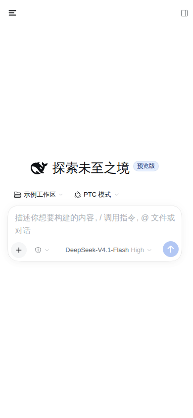
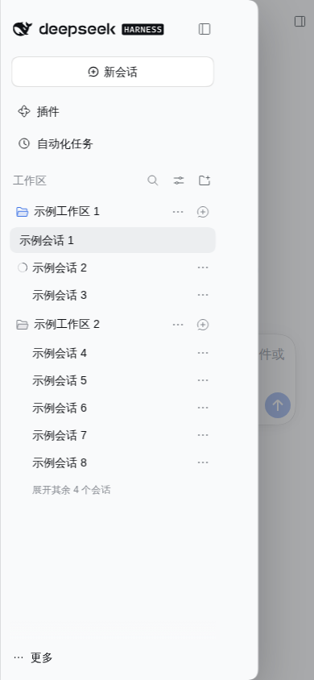
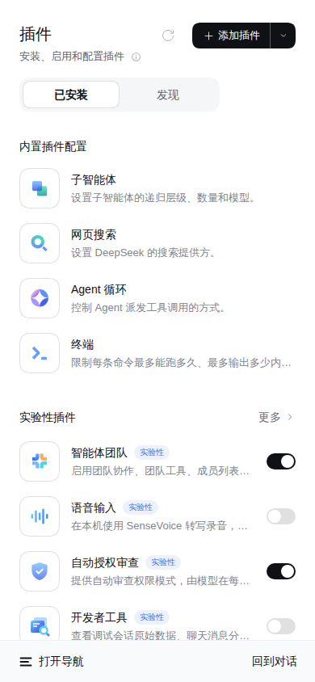
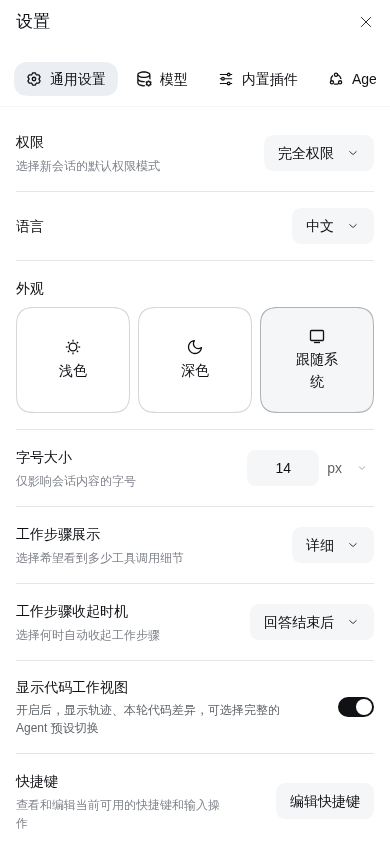

# dsh-mobile-ui

DSH Web 的**移动端外壳**插件。桌面浏览器不受影响：所有样式和组件都只在
`html[data-dsh-mobile]`（视口宽度 ≤ 767px）下生效。

## 界面预览

演示视频（18 秒、静音、WebM，工作区与会话名均为示例占位）：
[screenshots/demo.webm](screenshots/demo.webm)

移动端截图（演示数据，工作区与会话名使用示例占位）：

| 对话页 | 抽屉导航 |
| --- | --- |
|  |  |
| **全局面板（底部导航栏）** | **设置面板** |
|  |  |

## 做了什么

- **左侧栏不再占宽**：移动端原本常驻的 56px 图标竖条会吃掉约 14% 屏宽。现在左右两列
  都不占 grid 宽度，左栏改成**覆盖式抽屉**（84vw / 最大 320px，右缘圆角 + 阴影），
  对话区占满整屏。
- **抽屉行为**：顶部栏左侧新增汉堡键打开。点会话行、点「新会话」（含品牌区）、切全局
  面板会自动收起；点工作区里的「新建会话」会在会话真正创建后自动收起；点遮罩或按 Esc
  也会收起（有菜单打开时 Esc 只关菜单，抽屉留在原地）。抽屉里的就地操作（搜索、工作区
  展开、会话「…」菜单、底部「更多」菜单、菜单里的置顶/归档/设置）不会把抽屉关掉。
- **全局面板**：插件页、自动化任务这类面板底部有一条栏，左键开抽屉、右键回对话；
  全局面板页不会有"出不来"的死路。
- **设置面板**：移动端改为全屏、分类横向排列，主题选择三块并排。
- **安全区**：宿主侧把 `viewport-fit=cover` 写进页面，样式里用
  `env(safe-area-inset-*)` 给抽屉、顶栏、输入区留出刘海和小白条的位置。
- **键盘**：跟踪 `visualViewport`，用 `--dsh-mobile-vv` 让布局高度跟可见区域走，
  输入框不会被软键盘顶出屏幕。
- **不抢键盘**：切会话、新建会话、首次加载时输入框不再自动聚焦；点「＋」时它需要输入框
  焦点才能挂出菜单，所以只在同一轮点击内短暂聚焦、下一个任务立刻收掉，菜单照常出现。
  点菜单后再点输入框会先收起面板并进入输入；本来就在打字时点「＋」不会把焦点踢掉。
- **输入区**：加号/发送键保持正圆；模型名不再被自带实现的宽度上限截断（隐藏版本号、
  放宽上限）；底部统计（轮次/步数、token/缓存命中）按设置里的详细级别保留。
- **触屏可达**：自带界面的会话行「…」和工作区行「… / ＋」原本只在鼠标悬停时出现，
  触屏下常显，手机上也能够重命名、归档、置顶、在工作区新建会话。
- **阅读与密度**：正文 16px、代码 13.5px；去掉点击高亮块，控件最小高度 36px。

## 关掉它

- 临时：在地址后面加 `?dsh-mobile=off`。
- 彻底：插件管理里禁用 `dsh-mobile-ui` bundle。

## 结构

| 文件 | 作用 |
| --- | --- |
| `index.js` | 宿主半：`webServer.tapIndex` 注入 `viewport-fit=cover` 和首帧前的 `data-dsh-mobile` 标记 |
| `client.js` | 浏览器半：样式、视口标记、键盘高度、抽屉交互、顶部栏导航键、焦点守卫 |
| `cordis.patch.yml` | bundle 插入行 |
| `locale/{zh,en}.json` | 插件列表里的标题 / 描述 |

## 版本锚定

抽屉、遮罩、面板底栏使用的是自带框架上稳定的 `data-*` 锚点（`[data-slot="sidebar"]`、
`[data-slot="main"]`、`[data-shell-overlay]`、`[data-sidebar-collapsed]`、
`[data-row-key]`），不依赖哈希类名。DSH 升级后如果结构变了，样式会自动降级成
"没有移动层"，不会把桌面端弄坏。

设置页、主题块、统计 pill、加号按钮这几处用的是当前构建的哈希类名
（`.VOzbGW_*`、`_8HJdBW_*`、`bOPqQW_*`、`.uV2eYG_*`、`._7KE1Ra_*`），升级后会
静默退回桌面样式，同样不会崩。

## 验证

已按功能清单做过移动视口与桌面视口的回归验证（抽屉开合、会话切换、面板底栏、
设置全屏、输入条、无横向溢出、无控制台报错、桌面布局不受影响、逃生开关）。
验证截图不纳入仓库，避免把会话内容带进版本库。

真机上的软键盘、安全区这类只在真实设备才准的行为，以实际使用为准。

## 已知边界

- **真机输入法**：软键盘的弹出/收起时序、安全区数值，模拟环境量不出来，只能真机确认。
- **真实触屏**：滚动惯性、长按这类手势只做了样式预设。
- 半屏以上宽度（768–1023）仍走桌面版（56px 栏），没有平板专用布局。
- 输入条统计与设置页的少数版式依赖当前构建的哈希类名，升级后会静默退回桌面样式。
- 宿主半的 viewport meta 是全局替换的，桌面端也会带 `viewport-fit=cover`（无视觉影响）。
