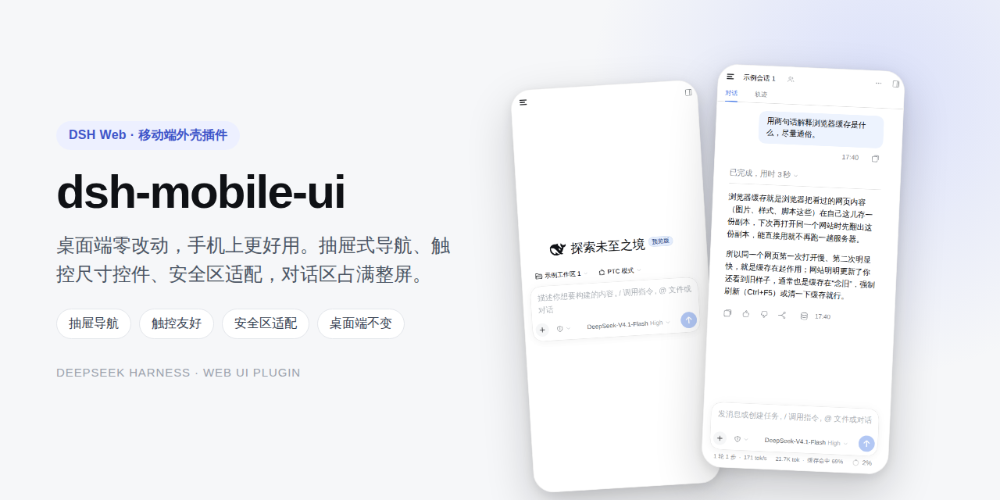
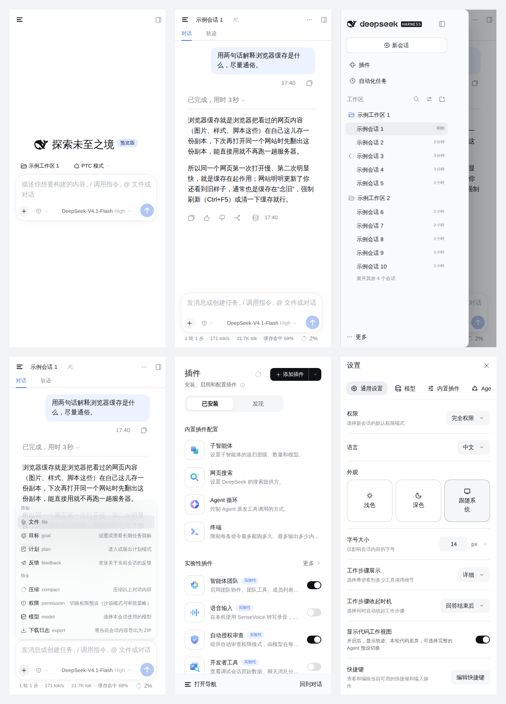

# dsh-mobile-ui




DSH Web 的**移动端细化层**。从 DSH 0.2.2-alpha.3 起，官方已经接管了手机端的抽屉导航；
这层不再自绘抽屉，只补官方还没覆盖的部分：刘海/小白条安全区、触控尺寸、输入不缩放、
头栏密度、终端按键条、长按排序。桌面浏览器不受影响——所有规则只挂在
`html[data-dsh-mobile]`（视口宽度 ≤ 767px）上。

## 界面预览



演示（GIF，工作区与会话名均为示例占位）：


> 截图与演示录制于 0.2.0；当时抽屉由本插件提供。0.3.0 起抽屉改为官方实现（含 opener、遮罩、
> Esc / 点会话 / 切面板关闭），外观接近，宽度与背板以官方为准。

## 适配策略：跟着官方走，只补缺口

- **只追最新版**：按 DSH Web **0.2.2-alpha.3** 构建并验证；不再回头维护更老版本的行为。
- **官方修好一块，这里就删一块**：0.2.2-alpha.3 已经做了手机抽屉、frame 左上 opener、
  全局面板顶部内边距、触屏会话行操作、手机端模型目录、浮层贴合 visualViewport 等，
  本插件 0.3.0 删掉了自绘抽屉、头栏汉堡键和面板底栏，避免和官方抢同一块 DOM。
- 每一条改动都能对应一个手机上真实存在的症状；没有症状的“更漂亮”不改。

## 做了什么（0.3.0）

- **安全区全覆盖**：宿主半把 `viewport-fit=cover` 写进页面，并补
  `apple-mobile-web-app-capable`；浏览器半把官方 chrome 避让刘海与小白条：
  - 官方抽屉：整列上/下/左安全区；横屏刘海时收缩侧栏内容宽度，而不是被裁掉；
  - 官方 opener（frame leading seat）：顶/左偏移加上安全区，标题行同步用同一个 clearance；
  - 对话头栏、全局面板（插件 / 自动化）、设置面板、通用弹窗、Toast、右侧栏标签条与
    面板底部、轨迹详情浮层；
  - composer 底部留出 home indicator。
- **头栏密度**：后台任务胶囊改成图标 + 数字（完整句子留在 `aria-label`），子代理计数只留图标，
  动作标签截断而不是把标题挤没；手机上模型名尽量显示（隐藏版本号、放宽触发器宽度），
  统计 pill 去装饰图标、收紧字号。
- **手机输入**：触屏（`pointer: coarse`）下所有文本框最小 16px，避免 iOS 聚焦自动放大；
  键鼠窄窗口保留官方字号。
- **阅读与密度**：正文 16px、代码 13.5px；去掉点击高亮；控件最小高度 36px。
- **右侧栏 / 轨迹 / 终端**：右栏标签条补安全区并允许横滑、关闭键放大到 28px 触摸盒；
  轨迹页官方 <760 的 92% 详情浮层补安全区；终端底部增加
  Esc / Tab / ↑ / ↓ / ← / → / Ctrl（粘滞）按键条。
- **触屏排序**：HTML5 拖拽在 iPhone 上不工作，所以对官方的 `draggable` 手柄做长按拖拽替代
  （设置里的模型排序、侧栏会话/工作区排序）。长按必须**保持不动**：手指在 450ms 内移动就按
  滚动处理；点按会在抬手时撤销计时器，不会给下一次点击留下“迟到的拖拽”。
- **输入框聚焦兜底**：设置 / 安装 / 自动化这类固定面板里的输入框聚焦后若被软键盘挡住，
  等键盘稳定后再滚进可见区域。

## 官方已经接管、这里不再做的

0.2.2-alpha.3 新增：

- 手机抽屉（<768px，覆盖式 + 遮罩 + 背景 inert）、frame 左上 opener、焦点归还；
  点会话 / 切全局面板 / 点遮罩 / 按 Esc 都会关闭；
- 全局面板顶部 48px chrome 内边距、插件与自动化页 <768 的 20px 页边距；
- 触屏会话行操作（More 常显、隐藏更新时间、置顶行 Unpin 在 More 前）；
- 手机端模型目录布局、浮层按 visualViewport 约束（软键盘弹出不越界）；
- 侧栏搜索框触屏 16px / 精确指针 13px、右栏 <768 自动全屏、hover 卡片忽略触摸、
  宽 Markdown 表格局部滚动、大图平移。

更早版本（0.2.2）已接管：设置页全屏 + 横向分类导航、主题三块并排、composer 手机焦点策略。

## 安装

前提：DSH Web **0.2.2-alpha.3 或更新**。`package.json` 里已经用
`engines.dsh: ">=0.2.2-alpha.3"` 声明了兼容范围：DSH 安装/启动时会按这个检查，低于该版本会
明确提示不兼容，而不是静默加载后再出问题。更老的版本没有上面“官方接管”的抽屉与面板内边距，
本插件也不代偿，不建议混用。

**方式一：插件市场（推荐）**

1. 在插件页打开实验性「自定义插件市场」（**插件 → 实验性插件 → 更多**）；
2. 切到「发现」标签，点「添加索引源」，填：

   ```
   https://kaijia323.github.io/dsh-mobile-ui/index.json
   ```

3. 找到「移动端界面」，点安装。

**方式二：GitHub 地址**

1. 打开 DSH Web → 左侧栏「插件」→ 右上「添加插件」；
2. 输入 `github:kaijia323/dsh-mobile-ui`；
3. 点「安装」，装完在插件列表里启用 `dsh-mobile-ui`。

**方式三：本地目录**

```sh
git clone https://github.com/kaijia323/dsh-mobile-ui.git ~/dsh-mobile-ui
```

然后在「添加插件」里填本地目录路径（例如 `/home/you/dsh-mobile-ui`）。

**方式四：npm 包名**

发布到 npm 之后，在「添加插件」里直接填包名即可（当前未发布）。

**装完怎么确认**

手机宽度（≤ 767px）打开：左上角是官方的侧栏 opener，点开是官方抽屉；本插件负责让这些
chrome 避开刘海/小白条、把头栏压紧、在终端底部加按键条。桌面宽度下布局与原来一致。

**卸载 / 临时关闭**

- 插件列表里禁用 `dsh-mobile-ui`；
- 或地址后加 `?dsh-mobile=off` 临时关闭（注意：DSH 首次带 token 打开会重定向并丢掉查询参数，
  要等登录 cookie 生效后再加这个参数）。

## 结构

| 文件 | 作用 |
| --- | --- |
| `index.js` | 宿主半：`webServer.tapIndex` 注入 `viewport-fit=cover`、iOS 独立应用声明和首帧前的 `data-dsh-mobile` 标记 |
| `client.js` | 浏览器半：安全区、头栏密度、触屏尺寸、终端按键条、长按排序、聚焦兜底 |
| `cordis.patch.yml` | bundle 插入行 |
| `locale/{zh,en}.json` | 插件列表里的标题 / 描述 |

## 版本锚定

- 兼容范围：`engines.dsh: ">=0.2.2-alpha.3"`（与 DSH 的插件兼容检查对接；不满足时安装/启动会提示不兼容）。
- 结构锚点（稳定）：`[data-slot="sidebar"]`、`[data-slot="main"]`、`[data-shell-overlay]`、
  `[data-shell-leading]`、`[data-sidebar-drawer]`、`[data-sidebar-mask]`、`[data-sidebar-opener]`、
  `[data-global-panel]`、`[data-slot="conversation.header"]`、`[data-row-key]`、
  `[data-conversation-region="composer"]`、`[data-composer-seat]`、`[data-dockkit-strip]`、
  `[data-dockkit-tab-close]`、`[data-sidebar-right-session]`、`[data-dockkit-pane]`、
  `[data-sidebar-terminal]`。
- 少数必须用构建类名的补丁：设置面板 `.VOzbGW_panel`、模型触发器 `._7KE1Ra_trigger` /
  `._7KE1Ra_triggerLabel`、统计 `.bOPqQW_pill`、输入区 `.uV2eYG_*`、子代理计数
  `.ZKlsPq_trigger`、轨迹 `.Y0dWHa_*`、Toast `[class*="_toast_"]`。
  这些在升级改名后会**静默失效**，其余补丁继续工作，不会把桌面或主界面弄坏。
- 已核对：0.3.0 用到的构建类名在 DSH 0.2.2-alpha.3 上存在并生效；跨版本官方可能改名，
  改名后对应补丁静默失效，不会崩。0.2.0 起不再使用 `nth-child` 这类结构假设。

## 验证

已用 Chromium 移动仿真（390×844、touch、iPhone 视口；CDP safe-area top 47 / bottom 34）逐项验证：

- 官方 opener 唯一（本插件不再注入汉堡键），位置 12/58；头栏 padding 57/20/28、
  标题行 48px leading clearance；无横向溢出；
- 抽屉：宽 280、上/下安全区 47/34、z-index 71 高于官方遮罩 70、抽屉内可点；
  点遮罩 / 按 Esc / 点会话 / 切插件面板都能关闭；
- 全局面板：顶部 95px（48 + 47）、底部 34px，页面保持官方 20px 侧边距，opener 常驻；
- 右侧栏全屏：标签条 padding-top 57、面板底部 34；终端按键条 7 键，底边 810（= 844 − 34）；
- 轨迹 92% 浮层：padding 47/34；
- 设置面板全屏 390×844、padding 47/34；通用弹窗容器 padding 47/34/16/16、max-height 763；
- 后台任务胶囊：`aria-label` 保留整句，可见文本只有数字；
- 合成触摸：静止长按 450ms 触发 dragstart → dragend；150ms 内移动 20px 则完全不产生 drag 事件；
- 700×390 + 左侧 47 安全区：opener 59/11、头栏左 47、clearance `calc(48px + 47px)`、
  抽屉左 47 且侧栏内容收缩不被裁切；
- `?dsh-mobile=off`：不注入标记，头栏恢复官方 10/20、opener 回到 12/11（交由宿主自行避让）；
- 1280×800 桌面：无 `data-dsh-mobile`，官方三栏（280 / 424 / 576），无按键条、无本插件相关报错。

**还需要真机确认**：iOS 安全区实测数值、软键盘弹出/收起时序、Safari 对 `DataTransfer` 构造的
支持（影响触摸拖拽排序）。

## 已知边界

- 只覆盖竖屏手机宽度（≤ 767px）。768–1023 以及横屏大屏仍走官方桌面/轨道布局（这是官方行为，
  本插件不代偿）。
- 终端按键条依赖 xterm 的隐藏 textarea；xterm 大版本升级后可能需要重新核对。
- 轨迹详情、设置面板的安全区补丁按构建类名 `.Y0dWHa_*.details` / `.VOzbGW_panel` 匹配；
  官方改名后只会少这层 padding，官方布局不变。
- 长按排序依赖浏览器能构造 `DataTransfer`（旧版 Safari 可能不支持）；不支持时排序静默禁用，
  其余功能正常。

## 发布

版本号、tag、GitHub Release、插件市场索引四处必须一起动；少一处，用户看到的还是旧版：

1. `package.json` 的 `version` 加一个补丁号，改动写进提交信息，推 `main`；
2. `git tag vX.Y.Z` 并推 tag；
3. 建 GitHub Release（`gh` 在 `~/.local/bin/gh`，已登录 kaijia323）：
   `gh release create vX.Y.Z -R kaijia323/dsh-mobile-ui --title "vX.Y.Z — <一句话>" --notes-file <notes> --latest`。
   正文照 0.2.x 的格式：改了什么 / 验证 / 怎么升级，末尾附
   `https://github.com/kaijia323/dsh-mobile-ui/compare/v<上一个>...vX.Y.Z`；
4. 同步市场索引（`gh-pages` 分支的 `index.json`）：在 `versions` 最前面插入
   `{"version": "X.Y.Z", "publishTimestamp": <unix 秒>, "source": {"type": "git", "url": "https://github.com/kaijia323/dsh-mobile-ui", "commit": "<tag 指向的 commit>"}}`，
   提交 `market: publish vX.Y.Z` 推到 `gh-pages`；
5. 核对三处线上状态：`gh release list` 里 `Latest` 是刚发的 tag、
   `https://raw.githubusercontent.com/kaijia323/dsh-mobile-ui/gh-pages/index.json`（立即生效）、
   `https://kaijia323.github.io/dsh-mobile-ui/index.json`（Pages 要等构建），最新版本都必须是刚发的那个。

## License

MIT
