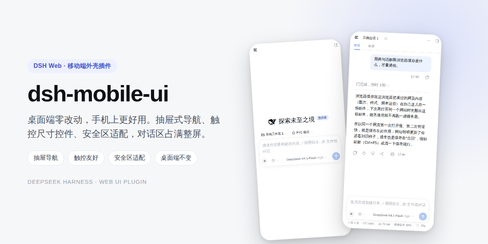
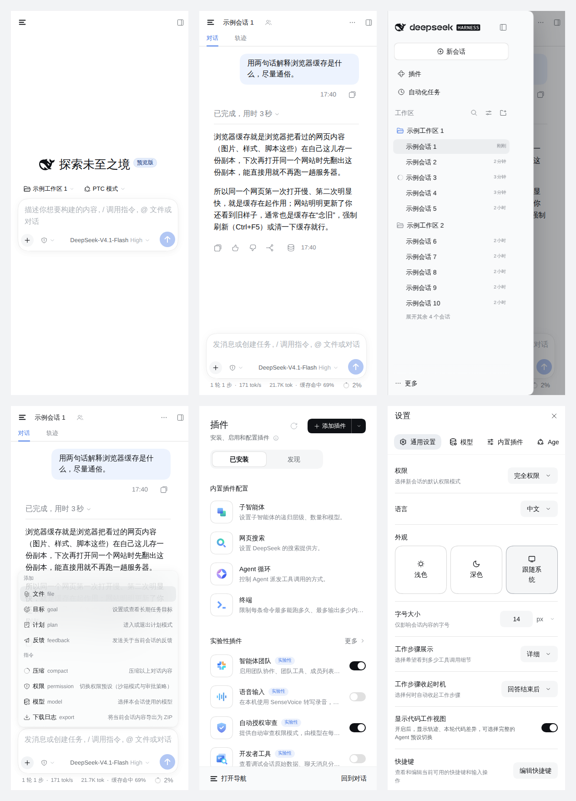

# dsh-mobile-ui




DSH Web 的**移动端补丁层**：给手机补上官方还没做、或者做得不够顺手的那部分。
桌面浏览器不受影响——所有规则只挂在 `html[data-dsh-mobile]`（视口宽度 ≤ 767px）上。

## 界面预览



演示（GIF，工作区与会话名均为示例占位）：


> 截图与演示录制于 0.1.x；0.2.0 起设置页导航改用官方移动布局（横向长条），其余交互一致。

## 适配策略：跟着官方走，只补缺口

- **只追最新版**：按 DSH Web **0.2.2-alpha.2** 构建并验证；不再回头维护 0.2.1 的行为。
- **官方修好一块，这里就删一块**：设置页全屏、触屏会话行操作、手机输入法焦点这些官方已经在 0.2.2 做了，本插件不再覆盖。
- 每一条改动都能对应一个手机上真实存在的症状；没有症状的“更漂亮”不改。

## 做了什么（0.2.0）

- **抽屉**：手机端原本常驻的 56px 图标竖条（约占 390px 屏宽 14%）不再占 grid；左栏改成覆盖式抽屉
  （84vw / 最大 320px，右缘圆角 + 阴影），对话区占满整屏。汉堡键在顶栏左侧，点会话行/新建会话/
  切全局面板会自动收起；点遮罩或按 Esc 也会收起。
- **安全区全覆盖**：宿主半把 `viewport-fit=cover` 写进页面，并补上 `apple-mobile-web-app-capable`；
  抽屉、顶栏、输入区、设置面板、通用弹窗、Toast、右侧栏标签条、面板底部导航都避让刘海与小白条。
- **键盘**：跟随官方策略（页面平移，不设 `interactive-widget`）；只在设置/安装/自动化这类
  固定面板里的输入框额外做“聚焦后滚进可见区域”，避免被软键盘挡住。
- **手机输入**：所有文本框最小 16px，避免 iOS 聚焦自动放大页面。
- **触屏操作**：HTML5 拖拽在 iPhone 上不工作，所以对官方的 `draggable` 手柄做了长按拖拽替代
  （设置里的模型排序、侧栏会话/工作区排序）；右栏标签条允许手指横滑；标签/关闭按钮放大到 28px。
- **右侧栏 / 轨迹 / 终端**：右栏在 <768 已由官方自动全屏，这里补标签条安全区和横滑；轨迹页
  官方 <760 已把事件详情做成 92% 浮层，这里只补安全区 padding，不改布局；终端底部增加
  Esc / Tab / ↑ / ↓ / ← / → / Ctrl（粘滞）按键条。
- **阅读与密度**：正文 16px、代码 13.5px；去掉点击高亮；控件最小高度 36px。
- **头栏**：动作标签截断而不是把标题挤没；子代理计数只留图标；后台任务胶囊缩成图标 + 数字。
- **输入区**：加号/发送键保持正圆；模型名尽量显示而不是过早折叠成图标（隐藏版本号、放宽上限）；
  统计 pill 去掉装饰图标、收紧字号，数字不被省略。

## 官方已经接管、这里不再做的

- 设置页全屏 + 横向分类导航、主题三块并排；
- 触屏会话行/工作区行的操作常显；
- composer 的手机焦点策略（不自动弹键盘、发送后收键盘）；
- 右侧栏 <768 自动全屏；
- hover 卡片忽略触摸；
- 宽 Markdown 表格局部滚动、大图平移。

## 安装

前提：DSH Web **0.2.2-alpha.2 或更新**。`package.json` 里已经用 `engines.dsh: ">=0.2.2-alpha.2"` 声明了兼容范围：
DSH 安装/启动时会按这个检查，低于该版本会明确提示不兼容，而不是静默加载后再出问题。
更老的版本缺少上面“官方接管”的部分，插件也不会代偿，不建议混用。

**方式一：插件市场（推荐）**

1. 在插件页打开实验性「自定义插件市场」（**插件 → 实验性插件 → 更多**）；
2. 切到「发现」标签，点「添加索引源」，填：

   ```
   https://kaijia323.github.io/dsh-mobile-ui/index.json
   ```

3. 找到「移动端外壳」，点安装。

**方式二：GitHub 地址**

1. 打开 DSH Web → 左侧栏「插件」→ 右上「添加插件」；
2. 输入 `github:kaijia323/dsh-mobile-ui`；
3. 点「安装」，装完在插件列表里启用 `dsh-mobile-ui`。

**方式三：本地目录**

```sh
git clone https://github.com/kaijia323/dsh-mobile-ui.git ~/dsh-mobile-ui
```

然后在「添加插件」里填本地目录路径（例如 `/home/you/dsh-mobile-ui`）。

**方式四：npm 包名**

发布到 npm 之后，在「添加插件」里直接填包名即可（当前未发布）。

**装完怎么确认**

手机宽度（≤ 767px）打开：左上角出现汉堡键、侧栏变成覆盖式抽屉、对话区占满整屏；
桌面宽度下布局与原来一致。

**卸载 / 临时关闭**

- 插件列表里禁用 `dsh-mobile-ui`；
- 或地址后加 `?dsh-mobile=off` 临时关闭（注意：DSH 首次带 token 打开会重定向并丢掉查询参数，
  要等登录 cookie 生效后再加这个参数）。

## 结构

| 文件 | 作用 |
| --- | --- |
| `index.js` | 宿主半：`webServer.tapIndex` 注入 `viewport-fit=cover`、iOS 独立应用声明和首帧前的 `data-dsh-mobile` 标记 |
| `client.js` | 浏览器半：样式、视口标记、抽屉交互、顶栏导航键、面板底栏、安全区、触屏增强、终端按键条 |
| `cordis.patch.yml` | bundle 插入行 |
| `locale/{zh,en}.json` | 插件列表里的标题 / 描述 |

## 版本锚定

- 兼容范围：`engines.dsh: ">=0.2.2-alpha.2"`（与 DSH 的插件兼容检查对接；不满足时安装/启动会提示不兼容）。
- 结构锚点（稳定）：`[data-slot="sidebar"]`、`[data-slot="main"]`、`[data-shell-overlay]`、
  `[data-sidebar-collapsed]`、`[data-row-key]`、`[data-conversation-region="composer"]`、
  `[data-composer-seat]`、`[data-dockkit-strip]`、`[data-sidebar-terminal]`。
- 少数必须用构建类名的补丁：设置面板 `.VOzbGW_panel`、模型触发器 `._7KE1Ra_trigger` /
  `._7KE1Ra_triggerLabel`、统计 `.bOPqQW_pill`、输入区 `.uV2eYG_*`、子代理计数
  `.ZKlsPq_trigger`、轨迹 `.Y0dWHa_*`、Toast `[class*="_toast_"]`。
  这些在升级改名后会**静默失效**，其余补丁继续工作，不会把桌面或主界面弄坏。
- 已核对：0.2.0 用到的构建类名在 DSH 0.2.2-alpha.2 上存在并生效；跨版本官方可能改名，
  改名后对应补丁静默失效，不会崩。0.2.0 起不再使用 `nth-child` 这类结构假设。

## 验证

已用 Chromium 移动仿真（390×844、touch、iPhone UA）逐项验证：

- 首屏标记、汉堡键、抽屉开合、点遮罩收起；
- 设置面板全屏、无横向溢出；
- 通用弹窗根层留白、对话框不超出视口；
- 右侧栏全屏、标签条可横滑、按钮最小 28px；
- 右栏标签的关闭键放大到 28px 触摸盒后仍与标签同轴（14px 图标回到官方像素位置，不溢出标签）；
- 终端按键条出现，Esc/Tab/方向键事件送达，Ctrl 粘滞后转发的组合键带 `ctrlKey`；
- 触摸长按拖拽的 DragEvent 协议（dragstart → dragover → drop → dragend）；
- 模拟刘海/小白条（CDP safe-area：top 47 / bottom 34，以及仅 bottom 34）：抽屉仍是 844px 不溢出，
  账号菜单可达，设置面板 390×844 + 对应 padding，右栏标签条 padding-top 57px；
- `?dsh-mobile=off` 恢复官方布局；
- 1280px 桌面视口：不注入 `data-dsh-mobile`，三栏宽度与官方一致，无 console 报错。

**还需要真机确认**：iOS 安全区实测数值、软键盘弹出/收起时序、Safari 对 `DataTransfer` 构造的支持
（影响触摸拖拽排序）、真实会话下官方轨迹浮层的组合效果。

## 已知边界

- 半屏以上宽度（768–1023）仍走桌面版（56px 栏），没有平板专用布局。
- 终端按键条依赖 xterm 的隐藏 textarea；xterm 大版本升级后可能需要重新核对。
- 轨迹详情的安全区补丁按 `.Y0dWHa_*` 匹配；官方改名后只会少这层 padding，官方布局不变。
- 设置面板只用 `.VOzbGW_panel` 补安全区；官方改名后少这层 padding，面板布局仍是官方的。

## License

MIT
